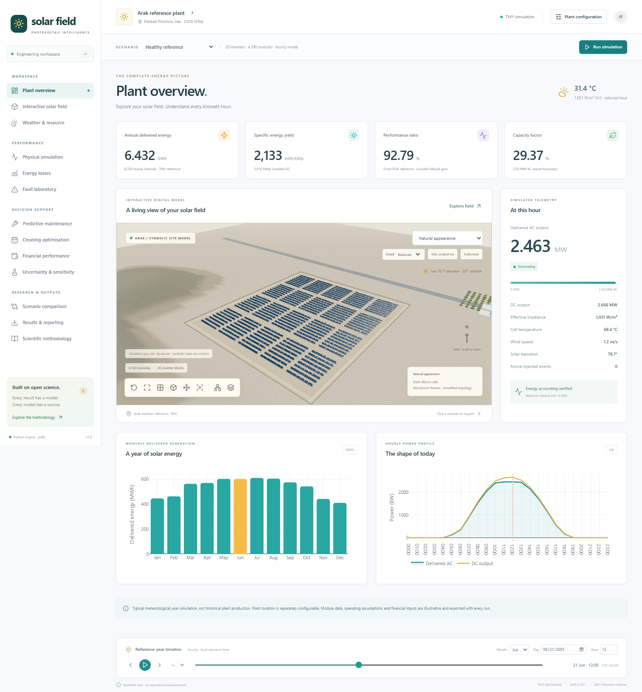
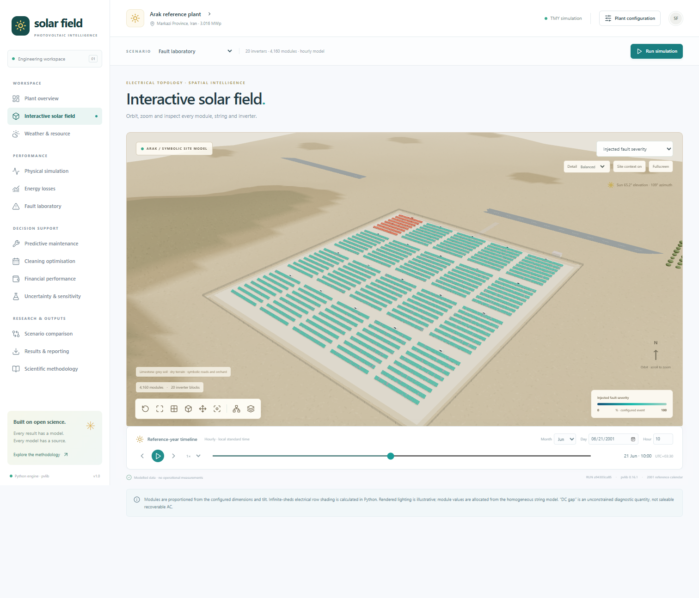
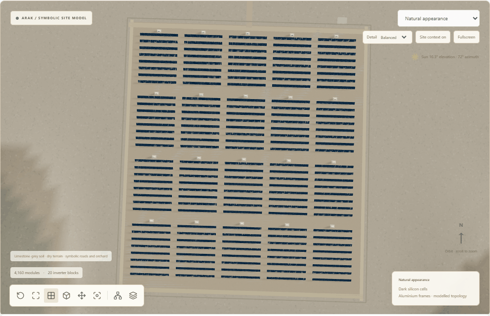
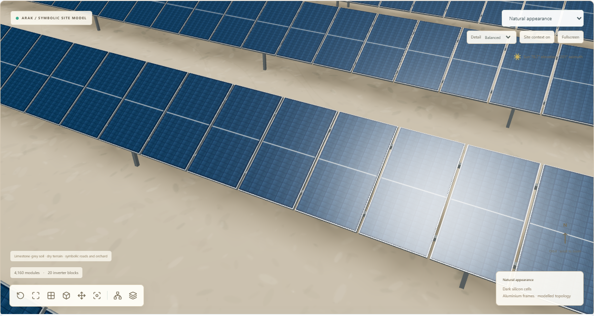
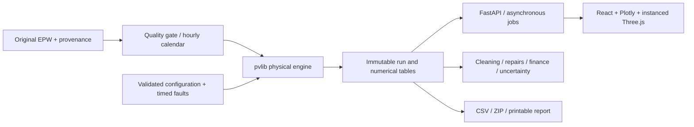

<div align="center">
  <strong>Developer: Behnam Mohseni Gharyehsafa</strong><br>
  PhD in Electronic Engineering<br>
  <a href="mailto:Mohseni.Gharyehsafa.Behnam@gmail.com">Mohseni.Gharyehsafa.Behnam@gmail.com</a>
</div>

# Solar Field Twin

A physics-based photovoltaic simulation and decision-support workspace: **Python calculations, an interactive React/Three.js solar field, and complete hourly numerical exports**.

The reference installation is an illustrative 3.016 MWp array in Markazi Province, Iran. Its weather comes from the public Arak TMYx EPW. This is a typical-year simulation and a digital-twin foundation, **not a monitored commercial plant or measured historical production**.

[Online application](https://behnamproject-arakpvpowerplant.onrender.com/) · [Deployment and free-hosting limits](docs/deployment.md) · [Security](SECURITY.md)

The symbolic site uses original procedural pale limestone-grey and beige soil, dry relief, tracks, an asphalt road, sparse buildings and an orchard, inspired by the supplied regional reference. It is not a surveyed plant map. Individual panels show half-cell patterns, aluminium frames, mounting rails and supports. Smooth camera controls, equipment focus, on-demand drawing, instancing, selectable detail and cached hourly snapshots keep navigation independent from annual calculations.



## Run it

Install **Python 3.13** and **Node.js 22+ with npm**. From this repository, on Windows or Linux:

```sh
python scripts/start.py
```

This creates `.venv`, installs the pinned Python dependencies, installs and builds the frontend, downloads and validates the weather, then serves the application at **http://127.0.0.1:8000**. The first run needs internet; subsequent simulations reuse the original cached EPW. Stop with Ctrl+C. With dependencies and the frontend already built:

```sh
python scripts/start.py --skip-install
```

Alternatively:

```sh
docker compose up --build
```

Docker keeps weather, runs and scenarios in the `solar-data` volume. Docker files are provided; local Windows validation uses the Python/Node workflow. See [installation](docs/installation.md) for manual Windows/Linux commands, development mode and browser-test setup.

## Engineering capabilities

* Safe, bounded TMYx ZIP download, SHA-256 provenance, pvlib EPW import, strict meteorological quality gate, alternative EPW uploads and station map.
* Coherent 365-day / 8,760-hour calendar in local standard time, with solar geometry at interval midpoints. No fabricated sub-hourly weather.
* Integer module → string → inverter topology; configurable plant location, module dimensions, orientation, row pitch, clearance, albedo and electrical assumptions. Missing electrical compatibility data remain visibly unverified.
* NREL SPA, Hay-Davies transposition, infinite-sheds front/rear irradiance and row shading, Faiman/Sandia temperature, PVWatts DC/AC, and optional De Soto with complete documented parameters.
* Instanced individual modules, orbit/pan/zoom, camera presets and equipment focus, module/string/inverter inspection, hourly playback, nine heatmaps and a 2D fallback.
* Timed combined equipment faults, healthy counterfactuals, residual and peer evidence, and transparent repair prioritisation using SciPy's open-source HiGHS MILP solver.
* Kimber soiling, no/fixed/threshold/economic cleaning comparisons and a constrained daily dynamic programme based on additional deliverable AC electricity.
* Sequential loss accounting with an explicit residual; discounted cash flows, NPV, payback and LCOE; reproducible Monte Carlo and one-at-a-time sensitivity.
* Persistent editable scenarios, actual Plotly charts, full annual CSV tables, equipment exports, comparison ZIPs, complete-run ZIPs and direct PDF/printable HTML technical reports.

All thirteen navigation sections contain implemented functionality. Physical calculations are independent of rendering and playback. Financial values and fault events are explicitly illustrative.







## Reproduce a calculation

Windows:

```powershell
.\.venv\Scripts\python.exe scripts\download_weather.py
.\.venv\Scripts\python.exe scripts\run_simulation.py --config examples\reference_configuration.json --output outputs\reference --analyses
```

Linux:

```sh
.venv/bin/python scripts/download_weather.py
.venv/bin/python scripts/run_simulation.py --config examples/reference_configuration.json --output outputs/reference --analyses
```

The output folder contains the complete 8,760-row plant CSV, configuration/provenance metadata, summary and an archive with weather, equipment, finance, analysis and PDF/HTML technical reports. `--analyses` adds diagnostics, cleaning optimisation and a 20-sample uncertainty demonstration. Without it, those sections are explicitly marked unexecuted.

For a standalone report:

```sh
python scripts/generate_report.py --output outputs/report.html --samples 40
python scripts/generate_report.py --output outputs/report.pdf --samples 40
```

Use the virtual-environment Python, or activate it first. The application also provides a direct PDF download and browser printing of the HTML report.

The verified reference EPW checksum and numerical results are recorded in [validation](docs/validation.md). Results are calculated at runtime; the interface contains no mock production data.

## Architecture



Backend: Python, pvlib, NumPy, Pandas, SciPy/HiGHS, FastAPI, Pydantic, NumPy Financial and Joblib. Frontend: React, TypeScript, Vite, React Three Fiber, Drei, Three.js, Plotly, Zustand, Leaflet, Tailwind CSS and Lucide. Python dependencies and npm dependencies have lock files.

## Verify

```sh
python -m pytest -q
cd frontend
npm test
npm run build
npm run test:e2e
```

Use the virtual-environment Python. Browser tests require the backend on port 8000 and either installed Microsoft Edge on Windows or Playwright Chromium (`npx playwright install chromium`). CI runs numerical, API, component and browser tests. See [validation](docs/validation.md) for coverage and the distinction between software verification and independent physical validation.

## Scientific boundaries

Module values are illustrative, not a verified manufacturer datasheet. Individual module telemetry is allocated from homogeneous strings. Infinite sheds assumes long parallel rows on flat terrain; local shading faults are reduced-order derates, not bypass-diode or hot-spot calculations. Faiman coefficients and soiling rates are uncalibrated engineering assumptions. The Arak EPW has incomplete usable rainfall, so default natural rain cleaning is explicitly disabled.

The conventional PR uses front irradiance and includes bifacial contribution. Loss attribution is sequential and order-dependent. Uncertainty distributions are assumed independent bounded factors; a single TMY does not establish site-specific interannual P90. Diagnostics on injected events do not establish field accuracy, and maintenance decisions require qualified inspection. Costs, currency and electricity values are illustrative; no Iranian tariff, subsidy or exchange rate is asserted.

The application is designed for local use. Internet-facing deployment requires appropriate authentication, TLS, resource limits and operational controls; these are not supplied as an enterprise service. There is no live SCADA connector or automatic control of electrical equipment.

## Documentation and attribution

[Architecture](docs/architecture.md) · [Installation](docs/installation.md) · [User guide](docs/user_guide.md) · [Scientific methodology](docs/scientific_methodology.md) · [Equations](docs/equations.md) · [Assumptions](docs/assumptions.md) · [Validation](docs/validation.md) · [API](docs/api.md) · [References](docs/references.md) · [Data handling](data/README.md)

Software is available under the [MIT licence](LICENSE). External libraries retain their own licences; weather and scientific references retain their owners' rights. The original weather archive is downloaded into an ignored local cache and is not redistributed in the source repository. No company branding, proprietary data or credentials are included. See [CITATION.cff](CITATION.cff) for software citation metadata.
