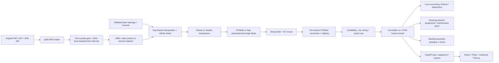

# Architecture and implementation plan

This repository models a configurable utility-scale photovoltaic plant using a typical meteorological year. It is a simulation and decision-support system; operational measurements are not supplied.

## Boundaries

* `backend/app/weather.py`: bounded archive ingestion, provenance, coherent non-leap calendar, missing-value handling and quality diagnostics. No paid services.
* `backend/app/config.py`: module, electrical, spatial, operational, fault and financial configuration. Integer topology is authoritative; capacity and layout are derived.
* `backend/app/engine.py`: common meteorology/solar geometry once, string-resolved DC and inverter-resolved AC. Module displays are explicitly allocated from homogeneous strings, not measured.
* `backend/app/analysis.py`: physical residual diagnostics, discounted economics, exact finite-horizon cleaning decisions, repair scheduling and parameter uncertainty.
* `backend/app/main.py`: asynchronous run jobs, cancellation, bounded uploads, persisted scenarios, exports, HTML technical reports and static production frontend.
* `frontend/src`: view state and API orchestration only; physics remain in Python. Camera/playback changes request equipment snapshots and never rerun annual physics.

## Numerical dependency map

EPW interval-end records → 2001 interval-start labels → midpoint geometry → unshaded front POA → infinite-sheds front/rear POA → soiled effective irradiance → module and cell temperature → DC before/after faults → per-inverter conversion → delivered AC. Each sequential loss is a difference between adjacent stages; signed thermal effects and bifacial gain remain visible. The accounting residual is independently checked.

Cleaning candidates must be evaluated through the inverter/export constraints. A dynamic programme chooses cleaning dates with a minimum interval and annual operation limit. Maintenance uses an open-source MILP solver through SciPy/HiGHS, prioritising declared safety-critical items before financial ranking. Uncertainty reruns physical scenarios using an explicit seed; P90 is the 10th percentile of the assumed parameter model, not a bankable interannual estimate.

## Incremental delivery and verification

1. Establish data ingestion, topology, physics and a reproducible annual run; test limiting cases before UI work.
2. Add front/rear irradiance, thermal alternatives, consistent energy accounting and metrics.
3. Build instanced module geometry and stable module/string/inverter selection with a 2D fallback.
4. Connect all thirteen application areas, plots, timeline and configuration to run results.
5. Add combined timed faults, residual evidence and spatial effects.
6. Add cleaning and repair decision support using explicit economic assumptions.
7. Add discounted finance and seeded uncertainty/sensitivity reruns.
8. Add hourly/equipment CSV, ZIP with provenance, report and reproducible scenarios.
9. Run numerical/API/component/browser checks; capture verified screenshots; document limitations and installation.

## Deployment

FastAPI serves the compiled Vite application in production. Docker provides one service with a persistent data volume. Development uses separate Vite and API services, with `/api` proxied to Python. A static-only host cannot execute this scientific backend.
